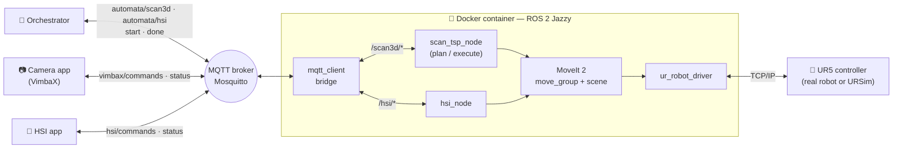
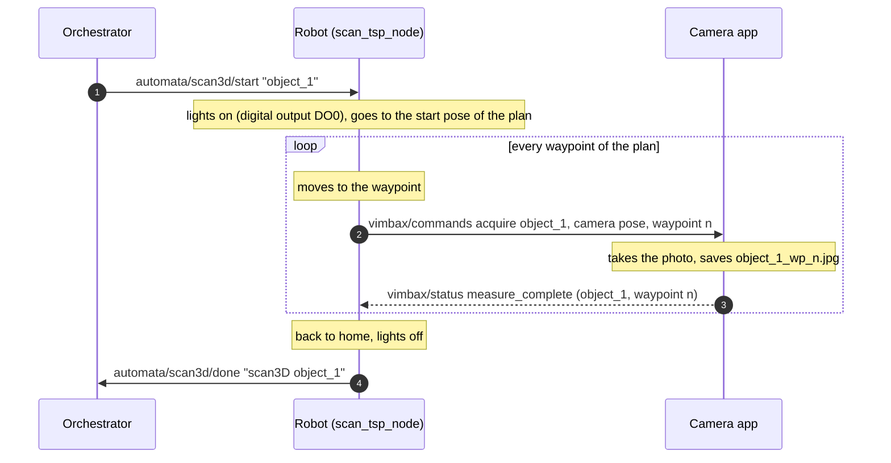

<h1 align="center">ur_automata — robotic 3D scanning cell</h1>

<p align="center">
  A Universal Robots UR5 moves a camera on a sphere around an object and takes a
  photo at every point, then places a hyperspectral sensor above it, driven by
  ROS 2 and MoveIt 2 and coordinated over MQTT.
</p>

<p align="center">
  
  
  
  
  
  
</p>

---

## What it does

1. An **orchestrator** asks for a scan of an object (`object_1`, `object_2`, …).
2. The robot switches the **scan lights** on and follows a **pre-computed plan** that visits the waypoints of a
   sphere (radius 0.25 m) around the object, with the camera always pointing at
   its center.
3. On every waypoint the robot **stops, asks the camera for a photo** and sends
   it the exact camera pose; it moves on when the camera says the photo is done.
4. At the end the robot goes back to `home`, switches the lights off and tells
   the orchestrator the scan is **done**.
5. On a second request the robot places the **hyperspectral sensor (HSI)**
   30 cm above the object, waits for the HSI measurement, goes back home and
   reports **done** again.

Highlights:

- 🗺️ **Planned once, executed many times.** The visit order (TSP with
  OR-Tools) and every motion are computed offline, checked against the cell and
  saved. A scan of 77 waypoints takes about **90 s of motion**.
- 🛡️ **Safe by design.** Before moving, the saved plan is checked against the
  current robot model and collision scene; if anything changed, the robot does
  not move and the reasons are listed.
- 🔌 **One command.** Robot driver, MoveIt, scene, scan, HSI and the MQTT
  bridge start with a single `ros2 launch`.
- 🧪 **Same code in simulation and on the real robot** (URSim or a real UR
  controller): only the IP and the calibration file change.

## How it fits together



One scan, step by step:



## Requirements

| | |
|---|---|
| **Robot** | Universal Robots UR5 (CB3 tested; the driver also supports e-series arms) with the [External Control URCap](https://github.com/UniversalRobots/Universal_Robots_ExternalControl_URCap), or **URSim** to try without a robot |
| **PC** | Ubuntu 24.04 (any Linux with Docker should work), Ethernet link to the robot |
| **Software on the host** | Docker Engine + `docker compose`, `nvidia-container-toolkit` (optional, see below), X11 for RViz, Mosquitto, Python 3 |
| **Camera** | [mqtt_client_tutorial](https://github.com/GDqbrobotics/mqtt_client_tutorial) VimbaX app: a simulated camera (`--device sim`) or a real Allied Vision camera |

Everything ROS (ROS 2 Jazzy, MoveIt 2, UR driver, OR-Tools, MQTT bridge) is
inside the Docker image: nothing ROS is installed on the host.

> No NVIDIA GPU? Remove the `deploy.resources.reservations.devices` section
> from `docker-compose.yaml`.

## Quick start

From a fresh machine to a scan on the real robot. To try it without a robot,
first follow [docs/ursim.md](docs/ursim.md) and then come back here.

### 1. Clone

```bash
git clone --recursive https://github.com/tonappa/ur.git ~/ur
cd ~/ur
```

`--recursive` also downloads the UR driver, a git submodule pinned to a tested
commit.

### 2. Build the Docker image (once)

```bash
sudo usermod -aG audio,video $USER    # once, then log out and back in
./run.sh build
```

### 3. Build the workspace

```bash
./run.sh run                          # opens a shell in the container
colcon build --cmake-args -DCMAKE_CXX_FLAGS="-w" -DBUILD_TESTING=OFF --executor sequential
source install/setup.bash
```

### 4. Broker and camera (host, once)

```bash
sudo apt install mosquitto mosquitto-clients python3-venv     # the broker starts as a service
git clone https://github.com/GDqbrobotics/mqtt_client_tutorial.git ~/mqtt_client_tutorial
python3 -m venv ~/venvs/vimbax
~/venvs/vimbax/bin/pip install -r ~/mqtt_client_tutorial/requirements.txt
```

### 5. Configure the cell

Everything is in **one file**:
[`ur_automata_bringup/config/automata_config.yaml`](src/automata_robot/ur_automata_bringup/config/automata_config.yaml).
For a new robot set at least `robot.ip`, `robot.type` and `robot.calibration_file`
(see [docs/real_robot.md](docs/real_robot.md) for the calibration), then
rebuild the config package:

```bash
colcon build --packages-select ur_automata_bringup && source install/setup.bash
```

### 6. Run a scan

Three terminals:

**Terminal 1 — camera** (host)

```bash
cd ~/mqtt_client_tutorial
~/venvs/vimbax/bin/python applications/VimbaX/vimbax_mqtt_app.py --device sim --measure-duration 0.5
```

**Terminal 2 — robot, MoveIt and scan** (container)

```bash
ros2 launch ur_automata_bringup ur_automata_bringup.launch.py
```

👉 Then press **Play** on the *External Control* program on the teach pendant.
Wait for `In attesa dell'oggetto su /scan3d/start`.

**Terminal 3 — start a scan** (host; this is what the orchestrator does)

```bash
mosquitto_pub -t 'automata/scan3d/start' -q 1 -m 'object_1'
```

The robot scans the object; the photos land in
`~/mqtt_client_tutorial/applications/VimbaX/measures/object_1/`. To watch the
messages: `mosquitto_sub -t 'automata/scan3d/#' -t 'vimbax/#' -v`.

**Then the hyperspectral measurement** (robot back in `home` after the scan):

```bash
mosquitto_pub -t 'automata/hsi/start' -q 1 -m 'object_1'
# the HSI app is still in development: answer by hand when the robot is above the object
mosquitto_pub -t 'hsi/status' -m '{"state": "measure_complete", "object": "object_1"}'
```

> ⚠️ **First time on a real robot:** keep the emergency stop within reach, set
> the speed slider on the pendant to 20–30 % and check in RViz that the scene
> (table, platform, object) matches the real cell.

## Everyday commands

All `ros2` commands run in the container. A second shell in the same container:
`docker exec -it ur_container bash`, then `source install/setup.bash`.

| I want to… | Command |
|---|---|
| run experiments (default plan, speed 0.4) | `ros2 launch ur_automata_bringup ur_automata_bringup.launch.py` |
| run slower or faster (scan and HSI) | `… ur_automata_bringup.launch.py speed:=0.5` (max 1.0 = as planned) |
| execute another plan | `… ur_automata_bringup.launch.py plan_file:=/home/ros/ur/recordings/<plan>.yaml` |
| compute a new plan (robot does not move) | `… ur_automata_bringup.launch.py mode:=plan plan_file:=/home/ros/ur/recordings/<new>.yaml` |
| plan in sectors instead of TSP | add `order:=sectors` (also `tsp`, `gtsp`; default `alternate`) |
| only robot + MoveIt, no scan and no HSI | `… ur_automata_bringup.launch.py use_scan:=false use_hsi:=false` |
| HSI measurement | `mosquitto_pub -t 'automata/hsi/start' -q 1 -m 'object_1'` (robot in `home`) |
| pause / resume a running scan | `ros2 service call /scan_tsp_node/pause std_srvs/srv/Trigger {}` · `…/start …` |
| test without camera / HSI app | set `scan3d.wait_for_next: false` / `hsi.wait_for_hsi: false` in the config |

After **every** restart of the bring-up press **Play** on the pendant again.
A new plan is needed only when the cell changes (platform, sphere, end effector,
TCP, robot model): the execute mode tells you if it is out of date.

## Configuration at a glance

[`automata_config.yaml`](src/automata_robot/ur_automata_bringup/config/automata_config.yaml)
is read by every launch file:

| Section | What is in it |
|---|---|
| `robot:` | controller IP, UR model, calibration file, base pose |
| `planning:` | MoveIt group, TCP link, home poses, speed of the planning, RViz/scene on or off |
| `scan:` | sphere center and radius, waypoint grid, IK and planner settings, platform mesh, keep-outs, walls |
| `scan3d:` | ROS topics of the photo handshake and of the scan lights, `wait_for_next` |
| `hsi:` | HSI distance above the object, speed, ROS topics, `wait_for_hsi` |

Robot digital I/O (e.g. the scan lights on DO0) is mapped to ROS topics in
[`ur_io_ros2_manager/config/config.yaml`](src/utils/ur_io_ros2_manager/config/config.yaml).

> The launch files read the **installed** copy: after editing the file run
> `colcon build --packages-select ur_automata_bringup` and `source install/setup.bash`.

Details: [docs/configuration.md](docs/configuration.md).

## Repository layout

```
ur/
├── docker/ · docker-compose.yaml · run.sh    Docker image and container
├── start_ursim_seccomp.sh                     URSim simulator (host)
├── recordings/                                saved scan plans (scan_tsp_real.yaml = real robot)
├── docs/                                      detailed documentation
└── src/
    ├── automata_robot/
    │   ├── ur_automata_bringup/        config file, launch files, RViz config
    │   ├── ur_automata_description/    URDF of the cell, end-effector mesh, camera TCP
    │   ├── ur_automata_moveit_config/  MoveIt configuration (SRDF, TRAC-IK, OMPL, Pilz)
    │   ├── ur_automata_scene/          collision scene: table, platform, object, keep-outs
    │   ├── ur_automata_scan/           sphere waypoints, IK, sequence planner (library)
    │   ├── ur_automata_scan_tsp/       scan_tsp_node: plan and execute the scan
    │   └── ur_automata_hsi/            hsi_node: hyperspectral measurement above the object
    └── utils/
        ├── Universal_Robots_ROS2_Driver/   UR driver (git submodule, read-only)
        └── ur_io_ros2_manager/             robot digital I/O on topics
```

## Documentation

| Page | Contents |
|---|---|
| [docs/real_robot.md](docs/real_robot.md) | network, kinematic calibration, power-on sequence, first motion |
| [docs/ursim.md](docs/ursim.md) | try everything in the official UR simulator |
| [docs/mqtt.md](docs/mqtt.md) | MQTT topics and messages, camera and HSI apps, orchestrator rules |
| [docs/scan.md](docs/scan.md) | how the scan is planned, all scan parameters, scene, measured results |
| [docs/configuration.md](docs/configuration.md) | config file, launch arguments, what to rebuild after a change |
| [docs/troubleshooting.md](docs/troubleshooting.md) | known problems and fixes |
| [ur_automata_scan_tsp/README.md](src/automata_robot/ur_automata_scan_tsp/README.md) | the TSP planning method in depth |
| [ur_automata_hsi/README.md](src/automata_robot/ur_automata_hsi/README.md) | the hyperspectral measurement: geometry, rules, usage |

## Known limitations

- The robot waits for the camera and the HSI app **without a timeout**: if they
  never answer, the robot stays where it is (stop it with Ctrl+C).
- The orchestrator only gets the final `done`; a robot status topic
  (ready / scanning / error) is not there yet. Send one command at a time and
  wait for its `done`.
- The HSI app is in development: its messages are simulated by hand for now.
- *Play* on the teach pendant is always manual.

## Built with

[ROS 2 Jazzy](https://docs.ros.org/en/jazzy/) ·
[MoveIt 2](https://moveit.ai/) ·
[Universal Robots ROS 2 Driver](https://github.com/UniversalRobots/Universal_Robots_ROS2_Driver) ·
[TRAC-IK](https://bitbucket.org/traclabs/trac_ik) ·
[OR-Tools](https://developers.google.com/optimization) ·
[mqtt_client](https://github.com/ika-rwth-aachen/mqtt_client) ·
[Eclipse Mosquitto](https://mosquitto.org/)
