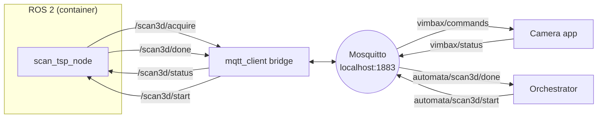

# MQTT interface: camera and orchestrator

[← back to the README](../README.md)

The robot talks to the outside world over **MQTT**. Inside ROS everything is on
`std_msgs/String` topics under `/scan3d/`; the
[`mqtt_client`](https://github.com/ika-rwth-aachen/mqtt_client) bridge copies
them to and from the MQTT broker. The bridge is started by the scan launch file
in `mode:=execute` only.



## Topics and messages

| MQTT topic | ROS topic | Direction | Message |
|---|---|---|---|
| `automata/scan3d/start` | `/scan3d/start` | orchestrator → robot | object name, e.g. `object_1` |
| `vimbax/commands` | `/scan3d/acquire` | robot → camera | `acquire: object_1; camera pose: [x, y, z, qx, qy, qz, qw]; waypoint_5` |
| `vimbax/status` | `/scan3d/status` | camera → robot | JSON `{"state": "...", "object": "object_1", "waypoint": 5, "timestamp": ...}` |
| `automata/scan3d/done` | `/scan3d/done` | robot → orchestrator | `scan3D object_1`, or `scan3D object_1 ERROR` if the scan stopped |

- **Camera pose**: position (m) and orientation (quaternion x, y, z, w) of the
  camera TCP `ee_automata_tcp` (lens center) in the `world` frame. The optical
  axis is the **Y** axis of that frame.
- **Waypoint number**: 1 at the north pole … N at the south pole, ring by ring,
  counterclockwise from +X inside a ring, counting only the waypoints of the
  plan. The robot visits them in the planned order, so the numbers arrive out
  of order.
- **Camera states**: `initializing`, `ready`, `measuring`, `measure_complete`,
  `error`. The robot moves on when it receives `measure_complete` with **its**
  object and waypoint; older messages are ignored.
- **done** is sent after the robot is back in `home`, so the object can be
  handled as soon as it arrives.

## Rules for the orchestrator

- Send `start` **without the retain flag**. A retained start would be delivered
  again every time the bridge reconnects and would start a scan nobody asked for.
- Send a new `start` only after the `done` of the previous scan: a start during
  a scan is ignored.
- Object names must not be only a number or `true`/`false`: the bridge would
  turn them into Int32/Bool and the robot would not receive them.

## Broker

[Eclipse Mosquitto](https://mosquitto.org/) on the host, installed as a
service (listens on `localhost:1883`, no password):

```bash
sudo apt install mosquitto mosquitto-clients
systemctl status mosquitto
```

The broker address is `broker.host` in
[`mqtt_bridge.yaml`](../src/automata_robot/ur_automata_bringup/config/mqtt_bridge.yaml).
If the camera or the orchestrator run on another PC, add a network listener to
Mosquitto (`/etc/mosquitto/conf.d/`) and point them to this PC.

## Camera app

The camera side is the VimbaX app of
[mqtt_client_tutorial](https://github.com/GDqbrobotics/mqtt_client_tutorial):

```bash
cd ~/mqtt_client_tutorial
~/venvs/vimbax/bin/python applications/VimbaX/vimbax_mqtt_app.py --device sim --measure-duration 0.5   # simulated
~/venvs/vimbax/bin/python applications/VimbaX/vimbax_mqtt_app.py --device real                        # Allied Vision camera
```

Photos are saved as `measures/<object>/<object>_wp_<n>.jpg` with a `.json` of
metadata (camera pose, waypoint). A new scan of the same object overwrites them.

## Test by hand

```bash
# watch everything
mosquitto_sub -t 'automata/scan3d/#' -t 'vimbax/#' -v

# start a scan as the orchestrator
mosquitto_pub -t 'automata/scan3d/start' -q 1 -m 'object_1'

# answer as the camera (when the camera app is not running), waypoint 5
mosquitto_pub -t 'vimbax/status' -m '{"state": "measure_complete", "object": "object_1", "waypoint": 5}'
```

To run the robot without any camera set `scan3d.wait_for_next: false` in
`automata_config.yaml`: it still sends the requests but does not wait.

## Changing topic names

ROS topic names are in the `scan3d:` section of `automata_config.yaml`, MQTT
topic names in `mqtt_bridge.yaml`. Change both sides together and rebuild
`ur_automata_bringup`.
