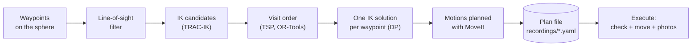

# The spherical scan

[← back to the README](../README.md)

- [How a scan is built](#how-a-scan-is-built)
- [Plan and execute](#plan-and-execute)
- [Scan parameters](#scan-parameters-scan)
- [Line of sight and arm occlusion](#line-of-sight-and-arm-occlusion)
- [Sectors and arm swings](#sectors-and-arm-swings)
- [Collision scene](#collision-scene)
- [The older sector method](#the-older-sector-method-scan_sequence_node)
- [Measured results](#measured-results)
- [Implementation notes](#implementation-notes)
- [Settings history](#settings-history)

## How a scan is built



1. **Waypoints**: a grid on a sphere centered on the object (`scan.center`,
   `scan.radius`), ring by ring; the camera always points at the center.
2. **Line of sight**: waypoints whose view of the center is blocked by a scene
   object (e.g. the platform stem) are dropped.
3. **IK candidates**: for each waypoint, the arm configurations that reach it
   without collisions and without the arm hiding the platform from the camera.
4. **Visit order**: OR-Tools solves a travelling-salesman problem on the
   waypoints (or the sector order, see `order`).
5. **DP**: a dynamic program picks one configuration per waypoint so that the
   arm travels as little as possible.
6. **Motion planning**: every segment is planned with MoveIt (Pilz PTP, then
   OMPL when the straight joint line collides); durations are measured and
   steps 4–6 are refined a few times.
7. The best plan is **saved**; the execute mode loads it, checks it and plays it.

## Plan and execute

Both modes are run by `scan_tsp_node`, from the one-command launcher (bring-up
and MoveIt included) or alone with `ur_automata_scan_tsp scan_tsp.launch.py`
when the bring-up already runs in another terminal.

**Plan** — the robot does not move, Play is not needed. The plan starts from the
current pose of the arm, normally `home`. It takes 6–7 minutes.

```bash
ros2 launch ur_automata_bringup ur_automata_bringup.launch.py mode:=plan \
  plan_file:=/home/ros/ur/recordings/<new name>.yaml          # order:=alternate (default) | tsp | gtsp | sectors
```

Always plan to a **new file** and compare: results change from run to run. In
the summary look at `Tempo della traiettoria` (motion time of the scan) and
`tratti OMPL` (fewer is better).

| `order` | visit order |
|---|---|
| `alternate` (default) | starts from the sector order, then TSP and DP in turn |
| `tsp` | TSP on the waypoints, then DP |
| `gtsp` | generalized TSP on all IK candidates (order and configuration together) |
| `sectors` | the sector order of the older method, then DP |

Plan again only when the cell changes: platform, walls, sphere, end effector,
TCP, base pose, calibration or `trajectory_scaling_factor`.

**Execute** — loads the plan and checks, before moving:

- scan settings (center, radius, waypoints) are the same as in the config;
- the current robot model puts the camera where the plan says (2 mm / 1°);
- no planned point collides with the current scene and no scene object moved;
- speed limits are unchanged.

If any check fails it lists the reasons and exits: plan again. Otherwise it
waits for objects on `/scan3d/start`. If the robot is not in the start pose of
the plan, it goes there first (Pilz PTP, then OMPL). `speed:=` (≤ 1.0) slows the
saved motions down without changing their path. RViz shows a camera frustum on
every waypoint: gray = to do, green = done.

More on the method, the timing of each phase and all the runs:
[`ur_automata_scan_tsp/README.md`](../src/automata_robot/ur_automata_scan_tsp/README.md).

## Scan parameters (`scan:`)

All in `automata_config.yaml`; rebuild `ur_automata_bringup` after a change.

**Geometry**

| parameter | effect |
|---|---|
| `center` | sphere center in `planning.global_frame` (m): top face of the platform disk |
| `radius` | sphere radius (0.25 m). The hardest constraint: larger values quickly push waypoints out of reach |
| `hemisphere` | `upper` \| `lower` \| `full` (upper first) |
| `direction` | `latitudinal` (ring by ring) \| `longitudinal` (meridian by meridian) |
| `num_rings`, `points_per_ring` | density in latitudinal mode (4 × 15) |
| `num_arc`, `points_per_arc` | density in longitudinal mode |
| `equator_exclusion_upper_deg`, `equator_exclusion_lower_deg` | forbidden band around the equator, per hemisphere |
| `stagger_rings` | even rings shifted by half a step: more uniform coverage |
| `adaptive_rings` | points per ring scale with `sin(theta)`: fewer near the poles |

**Camera orientation**

| parameter | effect |
|---|---|
| `lock_pitch` | `true`: TCP X axis horizontal. `false`: free rotation about the optical axis, searched for a valid IK |
| `pitch_search_range_deg`, `pitch_search_step_deg` | range and step of that search |
| `pitch_xparallel_bias` | `0` = any rotation is fine; higher values prefer X horizontal |
| `occlusion_check`, `occlusion_disk_radius`, `occlusion_margin` | drop IK solutions where an arm link hides part of the platform disk (sight lines to the center and 24 rim points, against the real arm meshes) |

**IK and planning**

| parameter | effect |
|---|---|
| `enum_ik_timeout` | IK timeout of the candidate enumeration |
| `planners` | planner chain per segment, first success wins: `[pilz_ptp, ompl]` |
| `ompl_algorithm` | OMPL planner (`RRTConnect`, `RRTstar`, …) |
| `planning_time`, `planning_attempts` | time and parallel attempts of one OMPL request |
| `retry_planning_times`, `retry_ompl_algorithm` | retries with more time (and RRTConnect) before a recovery pose |
| `fallback_search`, `fallback_radius_mm` | search a nearby point on the sphere when a waypoint has no IK |

| planner | what it does | when it fails |
|---|---|---|
| `pilz_circ` | arc on the sphere: the camera frames the object during the motion | not starting on the sphere, singularities, collisions |
| `pilz_ptp` | straight line in joint space, deterministic, ~10 ms | the line goes through an obstacle |
| `ompl` | sampling-based planner, last resort | RRTstar can miss narrow passages: see the retries |

The chain `[pilz_circ, pilz_ptp, stomp, ompl]` was measured slower (262 s vs
143 s) and STOMP was removed; to try it again, add `stomp_planning.yaml` back in
`ur_automata_moveit_config/config`.

## Line of sight and arm occlusion

Before the IK search, the segment waypoint → center is cast against the scene
objects. If something is in the way (typically the platform stem, seen from
below) the waypoint is marked `OCCLUDED` and dropped. Ignored: the object
itself, the keep-out volumes and hits within 3 cm of the center. It is a single
ray on the optical axis, not the whole field of view.

`occlusion_check` is different: it drops the IK solutions where the **robot
arm** hides part of the platform disk from the camera.

## Sectors and arm swings

Walking each ring all the way around forces the arm to change configuration
somewhere behind the object, with a large swing. With `sectors: 4` each
hemisphere is split into 4 azimuth slices visited one after the other.

| parameter | effect |
|---|---|
| `sectors` | slices per hemisphere; `0` = plain ring order |
| `sector_offset_deg` | rotation of the slices (`0` = centered on the robot side, `45` = boundaries on the robot axis) |
| `joint_cost_weight` | DP segment cost = elbow path + TCP path (m) + this × joint distance (rad) |
| `swing_threshold_m` | elbow travel above which a motion is counted as a swing |

## Collision scene

Published by `ur_automata_scene` when MoveIt starts.

| `platform_mesh` | content |
|---|---|
| `platform02.stl` | **in use**: the rotating platform with the stem 59 mm shorter than `platform01`, standing on the table with `center.z` 0.455 |
| `platform01.stl` | full platform, original stem: with the current pose it would end up 5.9 cm too high |
| `disk.stl` | only the Ø300 × 4 mm disk, no support |

`platform_sim: true` replaces the mesh with a disk on three legs. The object is
`meshes/ceramic_model.obj`, placed at `scan.center`. Moving the platform only
means changing `scan.center`.

Safety volumes (all in meters, `0` or `enabled: false` = off):

- `table_margin`: yellow keep-out slab on the table under the sphere (MoveIt
  collision checks are yes/no, this is the margin). Under the disk there are
  only ~28 cm: 2 cm already costs the lowest waypoints.
- `keepouts`: cylinders around the stem base, the stem, the disk (≥ 1 cm thick)
  and a box around the support block, only with `platform_sim: false`.
- `walls`: back, left, right walls and a ceiling (`top_z` above the highest
  waypoint plus the end effector). Limits: `back_y` ≥ −0.42, `right_x` ≥ 0.75.

The farthest point of the sphere is at `|center| + radius` from the base: with
this end effector keep it below ~0.91 m.

Every scene change requires a new plan.

## The older sector method (`scan_sequence_node`)

The package `ur_automata_scan` also contains the first method: it plans the
scan sector by sector **while moving** (calibration run), records it and plays
it back. It is not connected to MQTT; it is kept for comparison.

```bash
# calibration run: plans and moves, records recordings/scan_sequence.yaml
ros2 launch ur_automata_scan scan_sequence.launch.py record:=true
ros2 service call /scan_sequence_node/start std_srvs/srv/Trigger {}

# forecast only, no motion
ros2 launch ur_automata_scan scan_sequence.launch.py dry_run:=true

# replay
ros2 launch ur_automata_scan scan_replay.launch.py speed:=0.5
ros2 service call /scan_replay_node/start std_srvs/srv/Trigger {}
```

The same sector order with the TSP planner and the MQTT pipeline is
`mode:=plan order:=sectors`.

## Measured results

URSim, UR5 model, full sphere 4 × 15 (82 waypoints), radius 0.30 m.

| method | reached | motion time | joint travel | OMPL segments |
|---|---|---|---|---|
| `scan_sequence_node` (two calibrations) | 77 / 82 | 129.2 s, 115.0 s | 255.5, 223.8 rad | 3, 5 |
| `scan_tsp_node order:=alternate` (two plans) | 77 / 82 | 90.8 s, 96.4 s | 178.4, 186.8 rad | 1, 2 |

Evolution of the sector method (`scan_sequence_node`):

| run | reached | time | swings | elbow path | TCP path | OMPL |
|---|---|---|---|---|---|---|
| rings, joint-distance cost, no walls | 78 / 82 | 163 s | – | – | – | 7 |
| sectors 0°, elbow + TCP cost | 78 / 82 | 143 s | 20 | 20.0 m | 30.8 m | 5 |
| + sectors 45°, walls | 78 / 82 | 163 s | 12 | 14.0 m | 27.2 m | 5 |
| + RRT*, faster DP | 78 / 82 | 137 s | 13 | 11.4 m | 19.9 m | 3 |
| + whole platform visible, TCP on the lens | 77 / 82 | 130 s | 12 | 12.3 m | 17.9 m | 3 |

The first scan node (removed) reached 72 / 82 in 322 s. On the real UR5
(2026-10-09, radius 0.25 m, calibrated) the plan reaches 79 / 82 waypoints and
the first full scan completed 79 / 79.

Open points: 3–5 segments, mostly in the lower hemisphere near the stem, still
go to OMPL and are the largest motions; a set-back path (camera backs away,
moves, comes back) was tried and is never collision-free in this cell.

## Implementation notes

Details of the code worth knowing before changing it.

- **IK seeds**: the 8 TRAC-IK seeds (wrist, elbow, shoulder flipped) are an
  approximation of the 8 UR branches; if all branches must be found for sure,
  use the analytic UR IK instead.
- **Second IK attempt** near the reach limit: 20× longer timeout, also seeded
  from the 8 branches of the start pose (needed with the sector order on the
  far side).
- **Lazy DP**: when a segment turns out blocked, all pairs between the two
  layers are checked at once; checking one pair per iteration ran out of
  iterations and left segments to OMPL.
- **TSP costs** toward the nearest neighbours (`tsp_check_neighbours`) include
  the collision check of the straight line: without it the tour jumps between
  hemispheres through the platform.
- **PTP time estimate**: Pilz samples trajectories every 0.1 s; the node
  compares its estimate with the planned durations.
- **Pilz CIRC**: a plan is rejected when the arc ends on another IK branch
  (fixed 0.01 rad threshold; branches are tenths of a radian apart).
- **Arm envelope** of the dry run: link origins only, plus a fixed 0.10 m;
  use the collision meshes if that margin turns out too small.
- **`setWorkspace`** only bounds OMPL sampling, it is not a TCP limit.
- `scan_replay_node` has no photo handshake: that is `scan_tsp_node`.

## Settings history

Why the current values of `automata_config.yaml` were chosen (URSim, radius
0.30 m, full sphere 4 × 15, `scan_sequence_node` unless noted).

**Scan center**

| `center` | result |
|---|---|
| `[0.133, 0.40, 0.504]` | farthest point 0.955 m from the base: out of reach |
| `[0.133, 0.35, 0.504]` | 0.927 m, 9 mm out of reach |
| `[0.133, 0.35, 0.470]` | 82 / 82, 140 s, 2290 IK candidates |
| `[0.0, 0.374, 0.470]` | centered on the base axis: 82 / 82 but 181 s, the pan joint turns twice as much |
| `[0.133, 0.365, 0.470]` | 82 / 82, 132 s, 1977 candidates: the low ring gains, the others lose |
| **`[0.133, 0.375, 0.455]`** | 82 / 82, 139 s, 2457 candidates: same distance, flatter and lower sphere → **chosen**. Waypoints 46/47 keep 1–2 candidates (end effector vs forearm) wherever the center is |

Same center, later: 82 / 82, 124 s with the first wall (2026-09-08);
`platform01.stl` 79 / 82, 159 s (wp 38, 54, 60 collide with the platform);
\+ line-of-sight check 78 / 82, 171 s; rerun 2026-09-29 78 / 82, 163 s.

**Wall-mounted robot** (tried and dropped, back to the table): base z 0.455 →
63 / 82, 276 s, the 19 lost all in the lower hemisphere (arm through the disk);
base z 0.50 with the wall in the scene → 82 / 82 enumerated but 80 % of the
segments blocked, scan not run.

**Platform meshes**: `platform02.stl` (2026-10-09) is `platform01.stl` with the
stem 59 mm shorter, so its feet stand on the table with `center.z` 0.455;
`platform01.stl` and `disk.stl` share the old reference and would sit 5.9 cm
too high.

**Margins and walls**: `table_margin` 0.02 loses wp 46 (under the disk, robot
side), so it is 0. The walls are the arm envelope printed by the dry run
(sectors 4, offset 45) + 0.10 m; `right_x` raised to 0.76 because the
end-effector mesh reaches x 0.71 at `lower_scan_ready`.

**Planners**: `[pilz_circ, pilz_ptp, stomp, ompl]` took 262 s against 143 s
(arcs slower than lines, 25 CIRC failures on wrist acceleration limits, 5
STOMP timeouts): back to line + OMPL, STOMP removed. `RRTstar` replaced
`RRTConnect` as OMPL algorithm (2026-09-29): RRTConnect returned the first
random path, up to 2.7 m of elbow travel; RRTstar uses the whole
`planning_time` to shorten it. The retries use `RRTConnect` because RRTstar
found no path to wp 13 (under the platform) in 15 + 30 + 60 s.

**Collision check step**: `longest_valid_segment_fraction` in
`ompl_planning.yaml` is 0.001 (≈ 1.5°). With 0.01 (≈ 15°) the end effector
moved up to ~20 cm between two checks, a 4 mm disk was missed and move_group
rejected the plan (`ValidateSolution`).

**Pilz Cartesian limits**: with acceleration / deceleration at 2.25 / −5.0
(Setup Assistant defaults) the CIRC arcs on the sphere pushed `shoulder_pan`
and `elbow` to 6.6–7.0 rad/s² against the limit of 5 in `joint_limits.yaml`
and the arc was rejected (dp10 run): now 1.5 / −1.5 in
`pilz_cartesian_limits.yaml`.

**Visit order**: with 4 sectors the dry run sends 4 segments to OMPL instead
of 9 with the ring order. Tried and dropped on 2026-09-29: a home pose per
sector (never chosen by the DP), per-joint weights with an IK-branch penalty
instead of the Cartesian cost (20 forecast swings vs 13).
