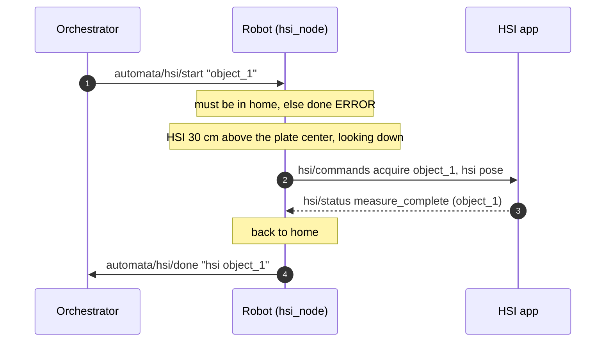

# ur_automata_hsi — hyperspectral measurement

After the 3D scan, the orchestrator asks for a hyperspectral (HSI) measurement
of the same object. `hsi_node` moves the HSI sensor above the object, asks the
HSI app for the measurement, waits for it, goes back home and reports done.



## Geometry

The HSI is on the same end effector as the camera and looks the same way (Y
axis of the frame). URDF frame `ee_automata_hsi`, on `tool0`:

| frame | x | y (forward) | z (from the flange) |
|---|---|---|---|
| camera `ee_automata_tcp` | 0 | 52 mm | 174.5 mm |
| HSI `ee_automata_hsi` | 0 | 72 mm (+20) | 91 mm (−83.5) |

Measurement pose: the HSI frame `hsi.distance` (0.30 m) above `scan.center`,
the Y axis pointing down at it. The rotation about the vertical axis is free:
the node tries one every 10°, solves the IK starting from `home` (TRAC-IK,
Distance mode), drops the solutions in collision with the scene and keeps the
one with the **smallest joint motion from home**, so the arm only stretches out.
The log prints the chosen rotation and the motion of each joint.

## Rules

- A measurement starts **only from `home`** (within 0.02 rad): otherwise it is
  refused with `hsi <object> ERROR`, so it can never start in the middle of a
  3D scan.
- A start received during a measurement is ignored.
- Motions: Pilz PTP, OMPL if the straight joint line collides. Speed: the
  `speed` argument of the launcher (default 0.4), the same as the scan:
  velocity scaling `trajectory_scaling_factor × speed`, acceleration scaling
  `trajectory_scaling_factor × speed²`, as when the scan slows down its plan.
- The scan lights stay off.
- If a motion fails the robot tries to go back home and reports `ERROR`.
- No timeout on the HSI app yet: the robot waits at the pose until
  `measure_complete` arrives.

## Usage

Started by the one-command launcher (`use_hsi:=true`, the default):

```bash
ros2 launch ur_automata_bringup ur_automata_bringup.launch.py
```

Then, from the host:

```bash
mosquitto_pub -t 'automata/hsi/start' -q 1 -m 'object_1'
# the HSI app is not ready yet: answer by hand when the robot is at the pose
mosquitto_pub -t 'hsi/status' -m '{"state": "measure_complete", "object": "object_1"}'
```

Without any answer: `hsi.wait_for_hsi: false` in `automata_config.yaml` (the
robot stays `hsi.wait_s` seconds at the pose and goes back).

On its own, with bring-up, MoveIt and the MQTT bridge already running:

```bash
ros2 launch ur_automata_hsi hsi.launch.py
```

Settings in the `hsi:` section of `automata_config.yaml`; MQTT topics in
`mqtt_bridge.yaml`; message format for the HSI app in
[docs/mqtt.md](../../../docs/mqtt.md).
